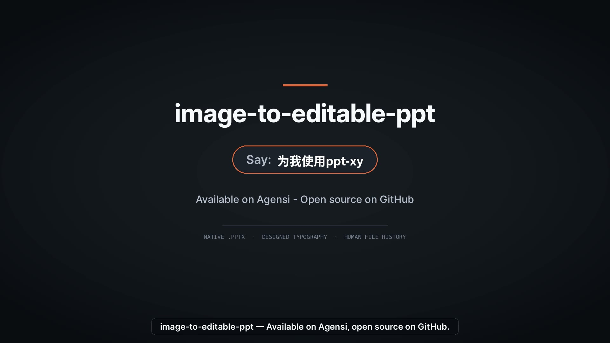

# image-to-editable-ppt

**English** | [简体中文](README.zh-CN.md)

> **PowerPoint that reads like a human made it.**

An offline skill pack that rebuilds images / PDFs / flattened slides into **editable, modern `.pptx`** files — and de-AIs existing decks so they read like human work.

## Watch the demo (77 seconds)

[](https://drive.google.com/file/d/1CatZZltrUNEKPM-Qyysx_8XpxfXNv8PG/view)

The three AI giveaways, the rebuild into native editable objects, the five human touches — and the file-history check nobody else does. Also available on [Agensi](https://www.agensi.io/skills/image-to-editable-ppt).

It combines three specifications:

- **de-ai-pptx v3.1** — compliance gate → forensic scoring (five-layer fingerprint) → `grill-me` alignment interrogation → five-layer refactoring → acceptance re-scan; plus author-from-scratch mode, three offline visual recipes, and a prompt template library
- **frontend-slides motion spec** — motion-preference question template, effect-to-feeling guide, and a single-file HTML web-deck option
- **Visual reconstruction** — page normalization → layered extraction → asset stripping & cleanup → native `python-pptx` rebuild → render QA
- **Bundled tools** (`tools/`, Python stdlib + `lxml` only, fully offline) — `hygiene.py` automates post-processing: XML/app.xml sync, three-slot font repair, and human-plausible `created`/`modified` timestamps with matching `TotalTime` and revision; `audit.py` is the read-only delivery gate (BLOCK/WARN findings, exit code 1 = do not deliver). **Running the tools requires an agent environment with code execution**; in chat-only environments, apply the same rules manually from `SKILL.md`.

## Trigger phrase

> **为我使用ppt-xy**

Say this phrase to activate the skill automatically. On the first turn it runs a `grill-me` alignment round first (visual style, whether motion effects are wanted and on which pages) before touching any file. Delivery is always a modern `.pptx` (OOXML) — never downgraded to legacy `.ppt`, never flattened into full-page images.

## File structure

```
image-to-editable-ppt/
├── SKILL.md                                  # Entry point: output format, page-by-page bespoke design, font pairing, hard bans, task routing
├── README.md                                 # English (default)
├── README.zh-CN.md                           # 简体中文
├── tools/
│   ├── hygiene.py                            # Post-processing: metadata/font-slot/timestamp hygiene
│   └── audit.py                              # Read-only delivery audit (BLOCK/WARN gate)
└── references/
    ├── de-ai-pptx-v3.1.md                    # Full de-AI specification (15 chapters, in Chinese)
    ├── frontend-slides-motion.md             # Motion & HTML web-deck extension (in Chinese)
    └── visual-reconstruction.md              # Visual-to-editable reconstruction, Route 4 (in Chinese)
```

## Four routes

1. **Refactor** — remove the AI feel from an existing `.pptx` through the five-phase pipeline
2. **Audit only** — forensic scoring and a dual-score report, no file changes
3. **Author from scratch** — build a deck from a topic or document that does not look AI-made
4. **Visual reconstruction** — convert screenshots, images, PDFs, or image-only decks into editable `.pptx`

## Usage

Place this repository in your AI assistant's skills directory (e.g. `skills/image-to-editable-ppt/`), or hand `SKILL.md` together with `references/` to your assistant, then say the trigger phrase “为我使用ppt-xy”.

Requirements: `python-pptx` (required), `Pillow` (optional), and the system tools `soffice` and `pdftoppm` for render QA. Fully offline — no templates or scripts are downloaded at runtime.

## Acknowledgements

Special thanks to **HXY** for their contribution and support.

Thanks also to the open-source project [zarazhangrui/frontend-slides](https://github.com/zarazhangrui/frontend-slides) (source of the motion spec) and to the `grill-me` interrogation protocol.

## Rights

The de-ai-pptx specification, the visual reconstruction workflow, and the integrated `SKILL.md` are the author's own original work. The motion spec is adapted from frontend-slides under the MIT License (full text in `licenses/`). See [`NOTICE.md`](NOTICE.md) for the full attribution.
